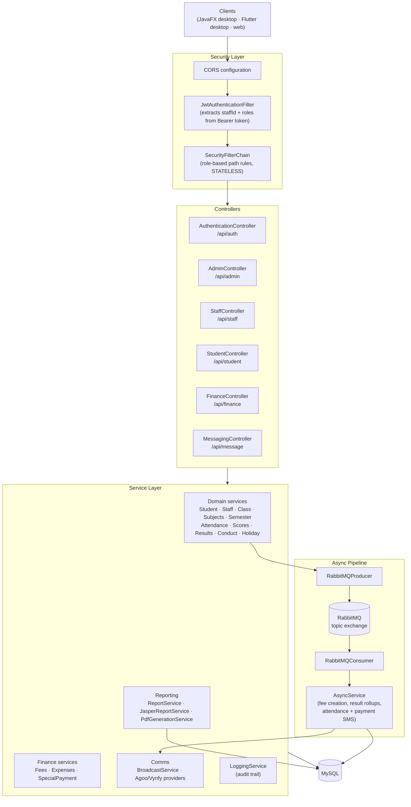
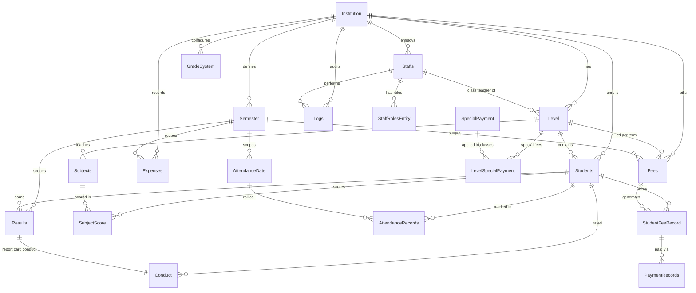
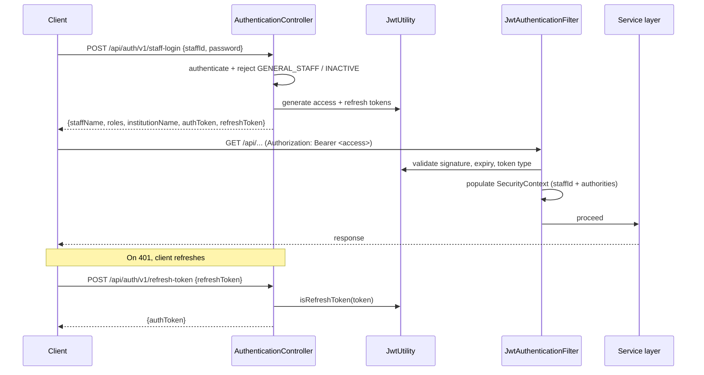

# School Management System — Backend

A multi-tenant **School Management System** REST API built with **Spring Boot 3.5.6** and **Java 21**. It powers the EazyManage desktop clients (JavaFX and Flutter) and handles institution onboarding, staff and student management, class/level and term administration, subject scoring and result compilation, conduct grading, attendance tracking, fee billing and payments, school expenses, special payments, SMS broadcasting, a two-dimensional audit log, and PDF report generation via JasperReports.

The system is **multi-tenant**: every record is scoped to an `Institution`, and a school joins the platform using a subscription code before any staff or students can be created.

---

## Tech Stack

| Concern | Technology |
|---|---|
| Language | Java 21 |
| Framework | Spring Boot 3.5.6 (Web, Data JPA, Security, Validation, AMQP) |
| Database | MySQL (`mysql-connector-j`), Hibernate `ddl-auto=update` |
| Auth | Spring Security + JWT (`jjwt` 0.11.5), stateless sessions, BCrypt |
| Async / messaging | RabbitMQ (`spring-boot-starter-amqp`) — topic exchange with durable queues |
| Reporting | JasperReports 7.0.3 + `jasperreports-pdf`; OpenPDF 2.0.3 for direct PDF assembly |
| SMS | Pluggable `SmsInterface`; Vynfy provider active (Agoo implementation retained but commented out) |
| Config | `dotenv-java` (loads `.env` into system properties at startup) |
| Boilerplate | Lombok |
| Build / deploy | Maven (wrapper included), multi-stage Dockerfile, Railway |

---

## Architecture Overview

Conventional layered Spring MVC architecture — **Controller → Service → Repository → Entity** — with DTOs crossing the controller boundary, a JWT filter in front of the controllers, a RabbitMQ pipeline for work that must not block the request thread, and a reporting layer producing PDF deliverables.



### Package layout

```
com.codewithben.schoolmanagementsystem
├── Config/          RabbitMQConfig, SecurityBean, SmsConfig
├── Constants/       Enums (roles, statuses, log types, conduct ratings, …)
├── Controller/      6 REST controllers
├── DTO/             Request/response records grouped by domain
├── Entity/          23 JPA entities
├── Interface/       SmsInterface (provider abstraction)
├── Repository/      23 Spring Data repositories
├── Service/         24 services (domain, finance, reporting, comms, messaging)
└── Utility/         JWT, auth provider, exception handling, auth event listeners
```

### Service layer

| Group | Services |
|---|---|
| Academics | `StudentService`, `StaffService`, `ClassService`, `SubjectsService`, `ScoresService`, `ResultsService`, `ConductService`, `AttendanceService`, `HolidayService` |
| Finance | `FeesService`, `ExpensesService`, `SpecialPaymentService` |
| Reporting | `ReportService`, `JasperReportService`, `PdfGenerationService` |
| Platform | `InstitutionService`, `LoggingService`, `CustomUserDetailsService` |
| Async / comms | `RabbitMQProducer`, `RabbitMQConsumer`, `AsyncService`, `BroadcastService`, `VynfySmsProvider` (`AgooSmsProvider` commented out) |

---

## Domain Model



### Entity notes

- **`EntityID_generation`** backs human-readable business IDs (e.g. `STD100200`) via a per-entity counter.
- **`Fees.isLocked`** freezes a term's fee amount once payments exist against it.
- **`SpecialPayment` / `LevelSpecialPayment`** model one special fee (stationery, admission, boarding) applied across several classes at a shared amount.
- **`Conduct`** is boolean/enum-driven (`ConductRatings`), not free text, so report cards render ticks consistently.
- **`Messages`** records each broadcast with audience, cost, and success/failure counts.
- **Soft deletion** is used throughout via `DeletionStatus` / `StudentStatus` / `StaffStatus` rather than row removal, so historical results and payments stay intact.

---

## Enums (`Constants`)

| Enum | Values |
|---|---|
| `StaffRoles` | PRINCIPAL, ACCOUNTANT, TEACHING_STAFF, GENERAL_STAFF, ADMINISTRATOR |
| `StaffStatus` | ACTIVE, INACTIVE |
| `StudentStatus` | ACTIVE, INACTIVE, GRADUATED |
| `AttendanceStatus` | PRESENT, ABSENT |
| `ConductRatings` | EXCELLENT, VERY_GOOD, GOOD, FAIR, NOT_TO_EXPECTATION |
| `SpecialPaymentType` | STATIONARY, ADMISSION_FEE, BOARDING, OTHER |
| `HolidayType` | PUBLIC_HOLIDAY, MID_TERM_BREAK, SCHOOL_EVENT, EMERGENCY_CLOSURE |
| `LogType` | ATTENDANCE, CONDUCT, FEES, PAYMENT, GRADE, INSTITUTION, CLASS, LOG, RESULT, REPORT, SCHOOL_HOLIDAY, TERM, STAFF, STUDENT, SUBJECT, SUBJECT_SCORE, EXPENSES, BROADCAST |
| `LogAction` | CREATE, READ, UPDATE, DELETE, PROMOTE, LOGIN, RESET, SUBSCRIPTION, SYNC |
| `LogStatus` | SUCCESS, FAILED |
| `DeletionStatus` | TRUE, FALSE |

---

## Audit Logging

Every meaningful operation is written to `Logs` through `LoggingService`, described along two axes — **what was touched** (`LogType`) and **what was done** (`LogAction`) — plus a `LogStatus` outcome, the acting staff member, the institution, and a date/time pair. Failed attempts are logged as deliberately as successful ones, so the audit trail shows attempted-but-rejected actions.

Login successes and failures are captured by `AuthenticationSuccessListener` / `AuthenticationFailureListener`.

Read back through:
- `GET /api/admin/v1/recent-logs`
- `GET /api/admin/v1/get-staff-logs`
- `GET /api/admin/v1/get-timely-logs`

---

## Roles & Authorization

Authorities are granted from the JWT `roles` claim and enforced per path prefix in `SecurityBean`:

| Path prefix | Allowed authorities |
|---|---|
| `/api/auth/**` | public |
| `/api/finance/**` | ACCOUNTANT, PRINCIPAL |
| `/api/student/**` | PRINCIPAL, ADMINISTRATOR, ACCOUNTANT, TEACHING_STAFF |
| `/api/staff/**` | ADMINISTRATOR, TEACHING_STAFF, PRINCIPAL, ACCOUNTANT |
| `/api/admin/**` | ADMINISTRATOR, PRINCIPAL, ACCOUNTANT, TEACHING_STAFF |
| `/api/message/**` | ADMINISTRATOR, PRINCIPAL |
| anything else | authenticated |

`GENERAL_STAFF` is explicitly rejected at login — the role exists for payroll/records purposes but carries no system access.

### Authentication & request flow



Tokens carry a `type` claim (`ACCESS` / `REFRESH`), so a refresh token cannot be replayed as an access token. The identity of the caller is always resolved server-side through `AuthenticatedStaffProvider` (which also yields the caller's `institutionId` for tenant scoping) — never from a client-supplied header.

---

## Async Pipeline (RabbitMQ)

Slow or fan-out work is published to a topic exchange (`school_management_exchange`) and consumed by `RabbitMQConsumer` → `AsyncService`, so the HTTP request returns immediately.

| Queue | Triggered by |
|---|---|
| `fee_creation_queue` | A new term fee is set for a class |
| `fee_update_queue` | A fee amount changes |
| `new_student_fee_creation_queue` | A student is enrolled and needs fee records |
| `create_results_queue` | Scores saved for a subject |
| `update_results_queue` | Scores amended |
| `daily_attendance_queue` | Attendance submitted (drives parent SMS) |
| `payment_report_broadcast_queue` | Payment recorded (drives payment SMS receipt) |

All queues are declared durable.

---

## SMS Broadcasting

`BroadcastService` sends institutional messages through the `SmsInterface` abstraction. **`VynfySmsProvider` is the active implementation**; `AgooSmsProvider` is kept in the tree but fully commented out, so exactly one bean satisfies the interface. Each provider is configured with its own URL, API key and sender ID, and outbound calls use a dedicated `RestTemplate` with 5s connect / 10s read timeouts. Each broadcast is persisted to `Messages` with audience, recipient count, cost and delivery counts.

Automated messages (daily attendance reports, payment receipts) are driven off the RabbitMQ queues rather than the HTTP path.

---

## REST API Reference

All endpoints below require `Authorization: Bearer <accessToken>` unless noted. The acting staff member and institution are derived from the token.

### `/api/auth` — Authentication & onboarding (public)

| Method | Path | Purpose |
|---|---|---|
| POST | `/v1/school-subscription` | Register an institution with a subscription code; returns the institution ID |
| POST | `/v1/enroll-new-principal` | Create the first PRINCIPAL account for a new institution |
| POST | `/v1/staff-login` | Authenticate; returns profile, roles, access + refresh tokens |
| POST | `/v1/refresh-token` | Exchange a refresh token for a new access token |

### `/api/admin` — Administration

| Method | Path | Purpose |
|---|---|---|
| POST | `/v1/reset-staff-password` | Reset a staff member's password |
| POST | `/v1/add-semester` | Create a term |
| GET | `/v1/search-semester/{semesterId}` | Fetch term details |
| PUT | `/v1/update-semester-info` | Update a term |
| POST | `/v1/new-grading-criteria` | Define a grading band |
| GET | `/v1/load-grading-criteria` | List grading bands |
| PUT | `/v1/update-grading-criteria` | Update a grading band |
| POST | `/v1/add-new-class` | Create a class/level |
| GET | `/v1/find-class-info/{levelId}` | Class details |
| PUT | `/v1/update-class-info` | Update a class |
| PUT | `/v1/update-staff-info` | Update staff details |
| POST | `/v1/add-subject` | Add a subject to a class |
| GET | `/v1/load-subject-data/{subjectId}` | Subject details |
| PUT | `/v1/update-subject-details` | Update a subject |
| DELETE | `/v1/delete-subject/{subjectId}` | Remove a subject |
| POST | `/v1/add-holiday` | Record a school holiday |
| GET | `/v1/load-holidays` | List holidays |
| PUT | `/v1/update-holiday` | Update a holiday |
| GET | `/v2/generate-class-report` | Class report cards (PDF) |
| GET | `/v2/generate-sba-report` | SBA report (PDF) |
| GET | `/v2/generate-master-sheet` | Master score sheet (PDF) |
| GET | `/v1/recent-logs` | Recent audit entries |
| GET | `/v1/get-staff-logs` | Audit entries for one staff member |
| GET | `/v1/get-timely-logs` | Audit entries within a date range |

### `/api/staff` — Staff & academics

| Method | Path | Purpose |
|---|---|---|
| GET | `/v1/total-staffs` · `/v1/total-teaching-staffs` | Headcount metrics |
| GET | `/v1/staff-list` · `/v1/load-staffs-info` | Staff listings |
| GET | `/v1/find-staff-by-id/{instructorId}` | One staff member |
| POST | `/v1/add-new-staff` | Enroll a staff member |
| GET | `/v1/load-class-info` | Classes for the signed-in teacher |
| GET | `/v1/load-levels` · `/v1/load-classes` | Class/level reference data |
| GET | `/v1/load-semesters` | Term reference data |
| GET | `/v1/load-subjects/{levelId}` | Subjects for a class |
| GET | `/v1/view-class-results` | Class results |
| GET | `/v1/report-card` · `/v1/view-sba` · `/v1/view-master-sheet` | Report previews |
| GET | `/v1/conduct-records` | Conduct for a student/term |
| PUT | `/v1/save-conduct-record` | Save conduct ratings |

### `/api/student` — Students, attendance, scoring

| Method | Path | Purpose |
|---|---|---|
| GET | `/v1/total-students` | Enrollment count |
| GET | `/v1/load-students/{levelId}` | Class roster |
| GET | `/v1/find-student/{studentId}` | Student profile |
| POST | `/v1/add-new-student` | Enroll a student |
| PUT | `/v1/update-student-data` | Update a student |
| GET | `/v1/load-subject-students/{subjectId}/{semesterId}` | Students to score |
| POST | `/v1/save-scores/{subjectId}/{semesterId}` | Save subject scores |
| GET | `/v1/load-students-for-attendance/{levelId}/{date}` | Roll-call list |
| POST | `/v2/mark-attendance` | Submit attendance |
| GET | `/v1/attendance-records` | Attendance history |
| GET | `/v1/dates-marked/{levelId}/{semesterId}` | Dates already marked |
| GET | `/v1/absent-students` | Today's absentees |
| PUT | `/v1/promote-student` | Promote to the next class |
| PUT | `/v1/repeat-student` | Repeat the current class |
| GET | `/v3/generate-report-card` | Student report card (PDF) |

### `/api/finance` — Fees, payments, expenses

| Method | Path | Purpose |
|---|---|---|
| POST | `/v2/new-fees` | Set a term fee for one or more classes |
| GET | `/v1/fetch-fees-details/{semesterId}` | Fee setup for a term (all classes) |
| PUT | `/v2/update-semester-fees` | Change a fee amount |
| POST | `/v1/add-fees-payment` | Record a payment |
| GET | `/v1/fetch-payment-records` | Payment history for a student |
| PUT | `/v1/update-payment-details` | Amend a payment |
| DELETE | `/v1/delete-payment-record/{transactionId}` | Remove a payment |
| GET | `/v1/search-fees-report` | Student fee position |
| GET | `/v1/fetch-grade-fees-report/{levelId}/{semesterId}` | Class fee report |
| GET | `/v1/class-summary-fees` | Per-class collection summary |
| GET | `/v1/total-fees` · `/v1/fees-paid` | Dashboard money metrics |
| GET | `/v1/recent-fees-transactions` | Latest payments |
| POST | `/v1/add-new-expenses` | Record an expense |
| GET | `/v1/read-expenses-records/{semesterId}` | Expenses for a term |
| GET | `/v1/total-expenses` | Total expenses this term |
| PUT | `/v1/update-expense-record` | Amend an expense |
| DELETE | `/v1/delete-expenses/{expensesId}` | Delete an expense |
| GET | `/v1/generate-expenses-report/{semesterId}` | Expenses report (PDF) |
| POST | `/v1/add-special-fee` | Create a special fee across classes |
| GET | `/v1/load-special-fees/{paymentType}` | Special fees by type |
| PUT | `/v1/update-special-fee` | Amend a special fee |

### `/api/message` — Broadcasting

| Method | Path | Purpose |
|---|---|---|
| POST | `/v1/broadcast-sms` | Send a bulk SMS to a targeted audience |
| POST | `/v1/broadcast-email` | Reserved — not implemented yet |

---

## Reporting Subsystem

PDFs are generated server-side and streamed to the client as bytes.

| Report | Produced by | Template |
|---|---|---|
| Terminal report card | JasperReports | `reports/student_report_card.jrxml` |
| SBA report | JasperReports | `reports/sba_report.jrxml` |
| Master score sheet | JasperReports / OpenPDF | `reports/` |
| Class report cards (batch) | JasperReports | per-student, merged |
| Expenses report | `PdfGenerationService` (OpenPDF) | built in code |

Report cards combine subject scores, computed class/exam splits, grading-band interpretation, conduct ratings, attendance totals and promotion status. Institution-specific assets live under `src/main/resources/reports/`.

> The runtime image installs `libfreetype6`, `fontconfig` and `fonts-dejavu` — JasperReports needs real fonts present or PDF generation fails on a slim container.

---

## Configuration

All secrets come from the environment (via `.env`, which is git-ignored). Required variables:

| Variable | Purpose |
|---|---|
| `MYSQL_URL`, `MYSQL_ROOT_PASSWORD` | Database connection (username is currently hardcoded to `root`) |
| `JWT_SECRET` | HS256 signing key |
| `JWT_ACCESS_EXPIRATION`, `JWT_REFRESH_EXPIRATION` | Token lifetimes (ms) |
| `SUBSCRIPTION_CODE` | Code required to register an institution |
| `RABBITMQ_HOST`, `RABBITMQ_PORT`, `RABBITMQ_USERNAME`, `RABBITMQ_PASSWORD` | Message broker |
| `AGOO_SMS_URL`, `AGOO_BULK_SMS_URL`, `AGOO_API_KEY`, `AGOO_SENDER_ID` | Agoo SMS provider |
| `VYNFY_SMS_URL`, `VYNFY_API_KEY`, `VYNFY_SENDER_ID` | Vynfy SMS provider |

Logging rolls to `logs/school-management.log` (10 MB per file, 14 days, 200 MB cap).

---

## Running Locally

```bash
# 1. Create the database
mysql -u root -p -e "CREATE DATABASE school_management;"

# 2. Provide a .env at the project root (see Configuration above)

# 3. Run with the Maven wrapper
./mvnw spring-boot:run

# Build a jar instead
./mvnw clean package
java -jar target/SchoolManagementSystem-0.0.1-SNAPSHOT.jar
```

Hibernate creates/updates the schema on boot (`ddl-auto=update`). The API listens on `:8080`.

### Docker

```bash
docker build -t eazymanage-api .
docker run -p 8080:8080 --env-file .env eazymanage-api
```

The Dockerfile is multi-stage (build on a JDK image, run on a JRE image) and installs the font packages JasperReports requires.

---

## Clients

This API serves the **EazyManage** desktop clients:

- **JavaFX desktop app** — the original deployed client.
- **Flutter desktop app** — the in-progress port (Windows + macOS), which adds offline-first queueing for payments, attendance and score uploads, syncing when connectivity returns.

Both authenticate with the same JWT flow and consume the endpoints above.

---

## Security Notes

- Secrets are environment-driven; `.env` and `logs/` are git-ignored.
- Passwords are BCrypt-hashed; sessions are stateless.
- Access and refresh tokens are type-tagged so they cannot be substituted for one another.
- The caller's identity and institution are always resolved server-side from the token, never trusted from the request body or headers.
- `ddl-auto=update` is convenient in development but should be replaced with a migration tool (Flyway/Liquibase) before further production schema changes.

---

## Project Facts

| Metric | Value |
|---|---|
| Java sources | 186 |
| Entities | 23 |
| Repositories | 23 |
| Services | 24 |
| Controllers | 6 |
| REST endpoints | 84 |
| Roles | 5 (4 with system access) |
